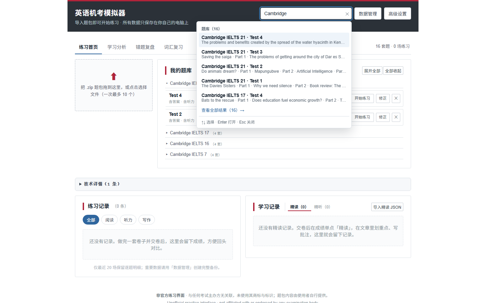
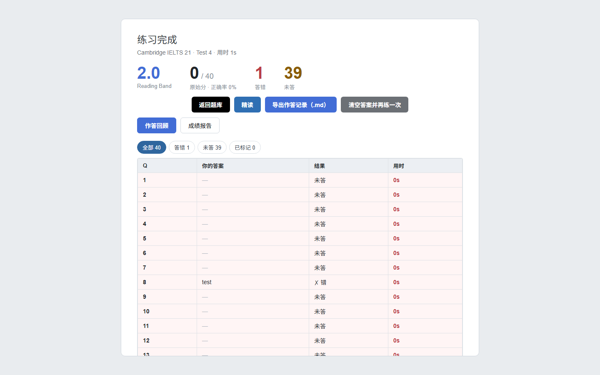
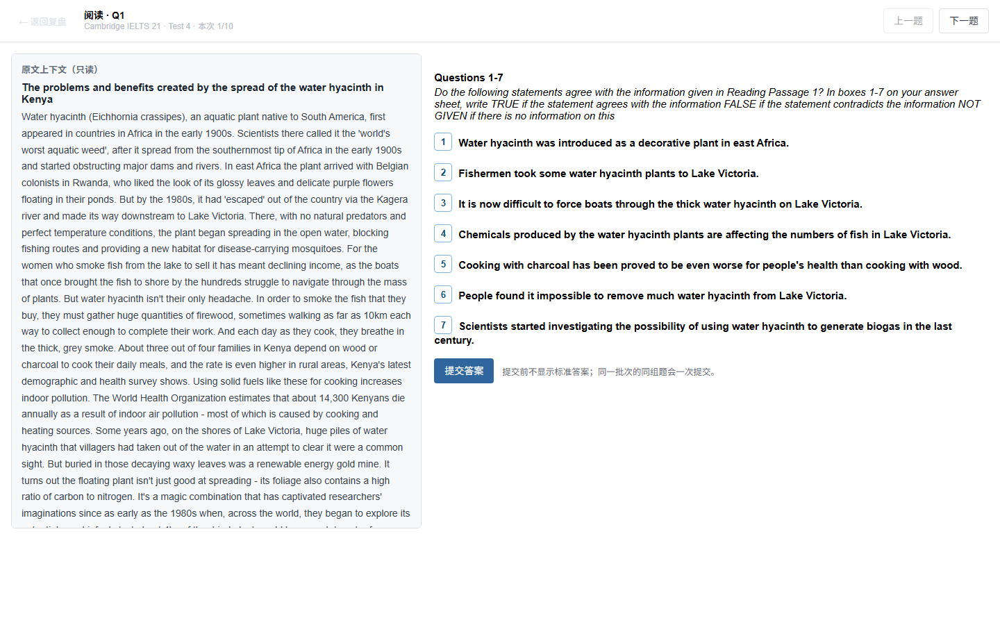

# 英语机考模拟器 / IELTS CBT Simulator

> 本地优先、无需账号的英语机考练习工具。阅读 · 听力 · 写作 · 精读 · 精听 · 错题复盘 · 间隔复习
>
> **非官方项目**：与任何考试主办方无关联，未使用其商标、标识或官方字体。仓库不附带任何真题题包，练习内容需自行导入。

一个运行在本机的英语机考模拟器。做题、判分、精读、精听、错题复盘和词汇复习都在本地完成；除了你主动配置的 AI 判改/词典接口外，不依赖联网，也没有账号、云同步或数据上传。

## 截图

| 首页（首次使用） | 统一搜索 |
| --- | --- |
|  |  |

| 成绩页 | 写作答卷历史 |
| --- | --- |
|  |  |

## 下载

到 [Releases](https://github.com/IamNotTommy/ielts-cbt-simulator/releases/latest) 下载：

- **Windows 10/11**：`ielts-cbt-simulator-v2.0.3.exe`，单文件，无需安装 Node；双击即运行。
- **macOS 10.15+**：`ielts-cbt-simulator-2.0.3-mac.zip`，解压后双击 `启动模拟器.command`。
  macOS 通常自带 Python 3；如果没有，先运行 `xcode-select --install`。首次打开如被拦截，
  右键 `.command` → 打开，或先运行 `解除隔离.command`。详见 [`mac/README.md`](mac/README.md)。

程序未签名，Windows 首次运行建议先按 [`docs/使用说明.txt`](docs/使用说明.txt) 开头的「解除锁定」步骤处理；也可以直接按下面的步骤从源码构建。

## 功能

### 做题

- 阅读：左右分栏、独立滚动、分栏比例记忆、高亮/笔记/删除线、题型齐全（判断、单选、多选、填空、标题匹配、特征匹配、段落信息匹配）。
- 听力：实考模式（连续播放）与练习模式（暂停/进度/倍速）；练习模式不限时。
- 写作：Task 1 / Task 2、实时词数、无拼写检查、题目图表快照。
- 全科连练：听力 → 阅读 → 写作，按实考顺序切换。
- 单篇 / 单 Section / 整卷 / 全套，严格实考计时或自定义计时。
- 自动保存、断点续做、未完成练习中心、交卷前未答/标记检查、真实作答墙钟计时。
- 答题时不做 AI 提示或答案泄露；标准答案只在复盘/精读中查看。

### 学习闭环

- **精读**：划词/划句批注、原文跳转、词典侧栏、词汇句子册。
- **精听**：自动断句、听写对比、AB 循环、错因、跟读录音、薄弱句统计。
- **写作答卷历史**：交卷保存不可变原稿 + 题目快照；修改稿独立自动保存；再次判改只绑定 `gradedEssays` 快照；版本对比。
- **错题复盘**：交卷自动收录答错/漏答；错因、状态、筛选；单题/同组题重做，不污染正式作答。
- **词汇间隔复习**：精读/精听同词合并；3 → 7 → 14 → 30 → 60 → 120 → 180 天；三档反馈；“不认识”本次最多重现 3 次。
- **学习分析**：整卷 Band 趋势、正确率趋势、题型正确率、写作四维、错题状态；低正确率题型可跳复盘。
- **统一搜索**：题库、练习记录、词汇与批注。
- **全量备份/恢复**：ZIP 导出/预检/合并/完整替换；默认不含 API Key 与模型配置。

> 错题复盘：筛选 → 同组重做 → 提交后查看本次/上次/标准答案，再标注错因与掌握状态。
>
> 

### 数据与隐私

- localStorage：题库索引、历史记录、学习数据、UI 设置；IndexedDB：音频、题图、写作答卷、跟读录音。
- Windows 启动器会把题库/历史/写作/学习数据额外镜像到 exe 同目录的本地文件夹，换浏览器或清缓存后可恢复。
- AI 模型配置（Base URL / API Key）只存在浏览器 localStorage，只在调用你配置的端点时使用；备份明确排除。
- 无遥测、无统计上报、无账号系统。

## 技术栈

- React 19 + TypeScript + Vite 7
- Tailwind CSS + Radix UI / shadcn 风格组件
- Recharts（学习分析）、JSZip（题包与备份）、pdfjs-dist（题包抽取）
- localStorage + IndexedDB
- Windows 单文件启动器：C# / .NET Framework 4.x（`csc.exe`，无需 Node 运行）

## 快速开始

### 环境

- Node.js **20+**（开发与构建）
- Windows 10/11（仅打包启动器需要；网页本身跨平台）

### 网页开发

```bash
npm install
npm run dev
# http://localhost:3000
```

### 构建

```bash
npm run build      # 输出 dist/
npm run preview    # 预览构建结果
```

### 打包 Windows 单文件启动器

```powershell
cd launcher
powershell -ExecutionPolicy Bypass -File .\build-launcher.ps1 -Dist ..\dist -OutDir ..
```

输出 `英语机考模拟器.exe`，内嵌 `dist/` 全部文件，双击即启动本机 HTTP 服务并打开浏览器。需要 Windows 自带的 .NET Framework 4.x；不需要额外安装任何东西。

### 打包 macOS 版

```bash
npm run build
bash mac/build-mac.sh
# 输出 mac-dist/ielts-cbt-simulator-2.0.3-mac.zip
```

Mac 版不使用 exe：`mac/launcher.py` 用 Python 3 标准库提供同样的静态文件与 `/api/*` 接口，
`网页应用/` 直接读磁盘。详见 [`mac/README.md`](mac/README.md)。

## 目录结构

```text
src/
  components/         界面（做题、成绩、精读、精听、复盘、分析、词汇、搜索、数据管理）
  lib/                数据层（存储、判分、同步、备份、SRS、分析、写作历史）
  prompts/            题包抽取提示词
  styles/app-v2.css   v2.0 新增界面样式（as-/sr-/wh-/rv-/vc-/an-/dm-/gs- 前缀）
launcher/             C# 单文件启动器与编译脚本
mac/                  macOS 启动器（Python 3）、.command 入口与打包脚本
docs/
  使用说明.txt         面向使用者的完整说明
  PACK_FORMAT.md       题包格式、字段说明与制作指南
  design/             功能实施规格与 UI 方案（历史设计文档）
  screenshots/        README 截图
CHANGELOG.md          v1.5 → v2.0 变更记录
```

## 题包

仓库**不包含任何题包**。题包是包含听力音频、阅读文章、写作题目和答案的 `.zip` 文件，请使用你自有的、合法取得的内容，从首页导入。

题包格式由 `src/lib/zipPack.ts` 解析；完整的字段说明、最小示例与常见错误见 [`docs/PACK_FORMAT.md`](docs/PACK_FORMAT.md)，题目抽取提示词见 `src/prompts/extract.md`。`.gitignore` 默认排除 `导入题目/`、`做题记录/` 等目录，避免误把题包和个人数据提交上去。

## 数据位置

网页端：

- `localStorage`：`ielts15-tests`、`ielts15-history`、`ielts15-learning-data`、`ielts15-ui-settings` 等。
- `IndexedDB`：`ielts15-media`（audio/images）、`ielts15-writing`（attempts）。

启动器可用时，exe 同目录下：

```text
导入题目/     数据/tests.json、媒体/、题包/
做题记录/     records.json、写作/<recordId>.json、学习数据.json
精读记录/     <testId>__p<idx>.json、词汇句子册.json
精听记录/     <testId>__s<n>.json、生词本.json
```

删除行为、备份格式与离线降级细节见 [`docs/使用说明.txt`](docs/使用说明.txt)。

## 已知限制

- 单用户、单机；没有账号、云同步或多人协作。
- 首版不含口语科目。
- AI 写作判改是可选功能，需要自备 OpenAI 兼容端点；评分仅供参考，非官方成绩。
- 题包不带听力原文/时间轴，精听需要粘贴一次原文后才能做听写、字幕与查词。
- 听力依赖题包内音频；缺音频时会给出明确提示。
- 浏览器建议 Chrome / Edge 89+（PDF 解析页面建议 94+）。

## 参与贡献

欢迎 Issue 与 Pull Request。

- 提交前请先跑通 `npm run build`。
- 不要提交题包、个人学习数据、`node_modules/`、`dist/`、`*.exe` 或任何 API Key。
- 新增功能请尽量保持现有数据兼容：新增持久化字段可选、旧数据可降级。
- 涉及做题状态机的改动，请同时更新 `CHANGELOG.md` 与 `docs/使用说明.txt`。

## 许可证

代码以 [MIT License](LICENSE) 开源。

- 第三方依赖各自遵循其许可证（见 `package.json`）。
- 仓库不包含真题题包、考试官方商标或官方字体；导入内容的版权与合规由使用者自行负责。
- 本项目与任何考试主办方无关联，也不代表其认可。

## 免责声明

本项目是个人练习工具，不提供、不保证任何考试成绩。AI 判分、正确率、Band 折算均为练习参考，非官方评分。使用题包时请遵守当地版权法规。
